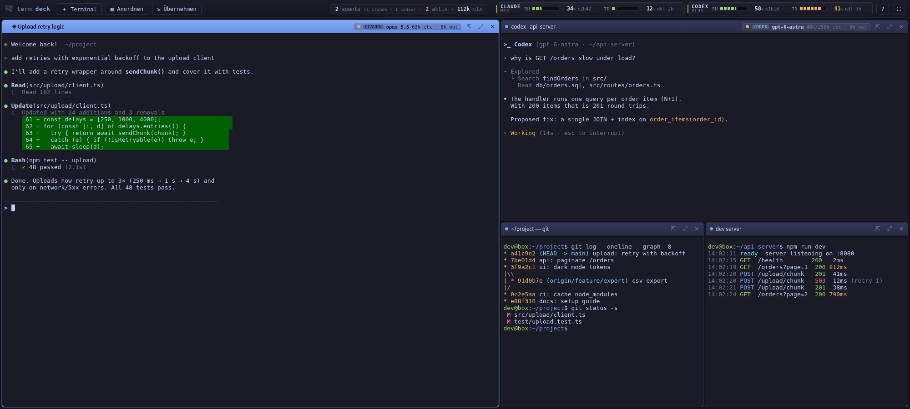
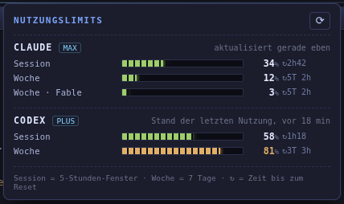

# termdeck

**A fullscreen tiling dashboard for your terminals, built for working with AI coding agents.**

termdeck puts all your terminals into one fullscreen window as tiles that always fill the whole screen.
Drag a tile to move it, drag a divider to resize it, pull it out into its own window and dock it back later.
It sees which tiles run **Claude Code** or **Codex**: each tile shows the model, the context size and whether
the agent is working. A bar at the top shows your **session and weekly usage limits for every account** you have
used with each provider, including several accounts per provider.



---

## Why

If you run several AI agents side by side, you end up with a pile of overlapping terminal windows:
some half off-screen, some buried, and no quick way to tell which agent is busy, which one waits for you
and how much of your plan is left. termdeck replaces that with one tidy, keyboard-friendly dashboard.

## Features

### Tiling that always uses the whole screen
- Every terminal is a tile in a split layout. There are no gaps and no overlapping windows.
- **Resize:** drag the divider between two tiles. Double-click a divider to reset it to 50/50.
- **Move:** drag a tile's title bar onto another tile. Drop it on an **edge** to dock it on that side, or in the
  **center** to swap the two tiles. A highlight shows where it will land.
- **New terminal:** splits the focused tile along its longer side and opens in the **same working directory**.
- **Arrange:** one click lays out all tiles as an even grid.
- **Zoom:** double-click a title bar to maximize a tile temporarily.

### Detach and dock
- Drag a tile to the top edge (a drop zone appears), or click **⇱**, to move it into its **own window**.
- The shell keeps running, and the screen contents and scrollback go with it.
- In the detached window, **⇲** docks it back into the dashboard.

### Pull in terminals from other windows
**⇲ Übernehmen** (*take over*) lists everything running outside termdeck:
- **Claude Code sessions** with their title, folder, status, model and context size.
  - **Idle:** one click ends the old process, closes its terminal tab and continues the session in a new tile
    with `claude --resume <id>`, with the full conversation history, the same folder and the same CLI flags.
  - **Busy:** *"when done"* waits until the agent is idle and then takes it over by itself. *"Now"* interrupts it.
- **Plain shells:**
  - **Idle:** opened in a new tile in the same folder, and the old window is closed.
  - **Running a program:** only the folder is opened, so nothing gets killed.

### AI agent status per tile
Tiles running an AI agent show a badge in the title bar:

```
● CLAUDE  opus 5.5   63k ctx · 8k out
● CODEX   gpt-6-astra  48k/258k ctx · 3k out
```

- Green dot: idle. Pulsing amber: working.
- `ctx`: the current context size (out of the window size where known). `out`: output tokens generated in this session.
- **Click the badge to switch the model.** For Claude Code you pick Opus, Sonnet, Haiku or Fable, and termdeck
  types `/model <id>` into that session. For Codex it opens Codex's own `/model` picker.
- The top bar sums it up: number of agents, how many are working, total context.

### Usage limits per account


- **One indicator per account**, labelled with the account's email address (or a name you give it).
  Several accounts of the same provider are listed separately, e.g. two Codex logins.
- **Every account that was ever logged in is remembered**, with its last known limits. The account you are logged
  in with now is marked `●` and updated live. Others are marked `○` and show their last known state.
- Segmented meters for each account: the **5-hour session** window (`5H`) and the **weekly** window (`7D`).
- Next to each meter: the percentage used and a countdown to the reset (`↻2h42`).
- Colors go from green to amber (≥ 70 %) to red (≥ 90 %).
- Click for details: every limit including model-specific weekly limits, exact reset times, when the data was
  last updated and extra usage credits (if enabled).
- **Manage accounts** in the details view: **✎** gives an account a name (useful if its email is not known yet),
  **✕** removes it. A removed account stays hidden until you log in with it again or use it again.
  The account you are logged in with cannot be removed.

<br clear="right">

### Session restore
termdeck saves the layout, the working directory of every tile and the Claude Code session running in it.
On the next start, the tiles come back as they were, and each Claude session continues with `claude --resume`.

### Terminal basics
- Built on [xterm.js](https://xtermjs.org/) with WebGL rendering, truecolor and 10 000 lines of scrollback.
- Tab titles set by programs (e.g. Claude Code's task titles) are shown in the title bar.
- A dot marks unseen output. A bell (e.g. "agent finished") turns the title bar amber.
- Copy and paste work the Linux way: select to copy into the primary selection and middle-click to paste. Also
  right-click (copy if text is selected, otherwise paste) and `Ctrl+Shift+C` / `Ctrl+Shift+V`.

---

## Requirements

- **Linux.** Developed and tested on Debian 13 with GNOME (X11). termdeck reads `/proc`, so it does not run on
  macOS or Windows.
- **Node.js ≥ 20** and npm
- A C++ toolchain for the native `node-pty` module: `build-essential` and `python3`
- Optional: [Claude Code](https://docs.claude.com/en/docs/claude-code) and/or [Codex CLI](https://github.com/openai/codex)
  for the agent features

## Installation

```bash
git clone https://github.com/stepHanB86/termdeck.git
cd termdeck
npm install          # also rebuilds node-pty for Electron (postinstall)
npm start
```

If your npm version blocks install scripts, allow them once and build:

```bash
npm install-scripts approve node-pty electron
node node_modules/electron/install.js
npx electron-rebuild -f -w node-pty
```

### Add it to your app menu
```bash
./install-desktop.sh
```
This installs a `.desktop` entry and the icon into `~/.local/share`, so termdeck shows up in GNOME's app grid
(and in other freedesktop-compliant desktops). Right-click → *Pin to Dash* to keep it in the dock.

## Keyboard shortcuts

| Action | Shortcut |
|---|---|
| New terminal (same folder) | `Ctrl+Shift+T` |
| Close terminal | `Ctrl+Shift+W` |
| Maximize / restore tile | `Ctrl+Shift+Enter` or double-click the title |
| Arrange all tiles evenly | `Ctrl+Shift+B` |
| Take over sessions from other windows | `Ctrl+Shift+O` |
| Move focus between tiles | `Alt+←/→/↑/↓` |
| Copy / paste | `Ctrl+Shift+C` / `Ctrl+Shift+V` |
| Font size bigger / smaller / reset | `Ctrl++` / `Ctrl+-` / `Ctrl+0` |
| Fullscreen on/off | `F11` |
| Show help | `?` button in the top bar |

---

## How the AI integration works

termdeck does not wrap or patch the agents. It reads the files they already write and looks at the process tree.

| | Claude Code | Codex CLI |
|---|---|---|
| Detect the agent in a tile | a `claude` process in the tile's process tree | a `codex` process (native or via node) |
| Session ↔ process | `~/.claude/sessions/<pid>.json` (session id, status, folder) | newest rollout in `~/.codex/sessions/` with the same folder, started after the process |
| Model, context, output tokens | the session transcript `~/.claude/projects/<folder>/<id>.jsonl` (read incrementally) | `turn_context` and `token_count` events in the rollout file |
| Working / idle | `status` in the session file | `task_started` / `task_complete` events |
| Usage limits | live: the same usage endpoint Claude Code's `/usage` uses, polled once a minute | the `rate_limits` data Codex writes into its rollout files |
| Account identity | `oauthAccount` in `~/.claude.json` (email, organization) | the ID token in `~/.codex/auth.json` (email, plan); every rollout file records the account that created it |

### Privacy
- Everything stays on your machine. The **only** network request termdeck makes is the Claude usage query to
  `api.anthropic.com`, using the OAuth login Claude Code already stored in `~/.claude/.credentials.json`.
  termdeck only reads that token. It never refreshes, stores or sends it anywhere else.
- Codex limits come from local files only. They show the state of your **last Codex activity**, and the details
  popover says how old they are.

### Caveats
- The Claude usage endpoint is internal to Claude Code and not a documented public API. It may change with a
  Claude Code update. If it fails, termdeck keeps the last known values and shows a warning.
- If the Claude login token has expired, open any Claude Code session once. Claude Code refreshes the token.
- Live limits are only available for the Claude account you are currently logged in with. Other Claude accounts
  show their last known state.
- A Codex account's email address is only stored locally while you are logged in with it. Accounts seen only in
  older session files appear as `Konto <id>` until you log in with them once while termdeck is running, or until
  you name them with ✎.
- Codex sessions are matched to tiles by folder and start time. Two Codex sessions started at the same moment
  in the same folder could be mixed up.

---

## Files and configuration

| What | Where |
|---|---|
| Saved layout and sessions | `~/.config/termdeck/session.json` |
| Known accounts and their last limits | `~/.config/termdeck/accounts.json` (no tokens are stored) |
| Desktop entry | `~/.local/share/applications/termdeck.desktop` |
| Icon | `~/.local/share/icons/hicolor/{scalable,256x256}/apps/termdeck.*` |

The shell comes from `$SHELL` (fallback `/bin/bash`). Terminals get `TERM=xterm-256color`, `COLORTERM=truecolor`
and `TERM_PROGRAM=termdeck`.

## Project structure

```
main.js            Electron main process: windows, PTYs, detach/dock routing, session save,
                   agent detection (Claude/Codex), usage limits, take-over logic
preload.js         the small IPC bridge exposed to the UI as window.deck
app/index.html     top bar and overlays
app/renderer.js    tiling tree, drag & drop, detach, badges, limits bar, take-over dialog
app/style.css      theme
assets/            icon (SVG + 256 px PNG)
install-desktop.sh app menu entry
```

The layout is a binary split tree (`{type:'split', dir, ratio, a, b}` / `{type:'leaf', id}`). Tile DOM nodes are
reused when the tree changes, so terminals never lose their state while you move them around.

### Headless test mode
For development and screenshots, termdeck can run without a visible window:

```bash
TERMDECK_SHOT=/tmp/shot.png \
TERMDECK_SCRIPT='newTerminal()' \
TERMDECK_SESSION=/tmp/test-session.json \
npx electron .
```

| Variable | Purpose |
|---|---|
| `TERMDECK_SHOT` | run hidden, take a screenshot to this path, quit |
| `TERMDECK_SCRIPT` | JavaScript run in the dashboard after start |
| `TERMDECK_SINGLE_SCRIPT` | JavaScript run in a detached window after it opens |
| `TERMDECK_SESSION` | use a separate session file (keeps your real layout untouched) |
| `TERMDECK_ACCOUNTS` | use a separate account store |
| `TERMDECK_CLAUDE_DIR` / `TERMDECK_CODEX_DIR` | read agent data from test folders instead of `~/.claude` / `~/.codex` |
| `TERMDECK_W` | window width in test mode |

## Roadmap ideas
- More agents (Gemini CLI, Aider, …) and their limits
- English UI (the interface is currently German)
- Restore detached windows on startup
- Named layouts / workspaces
- Notify when an agent finishes while its tile is not visible

## License

MIT, see [LICENSE](LICENSE).

---

<p align="center">Made with ❤️, ☕ and code.</p>
